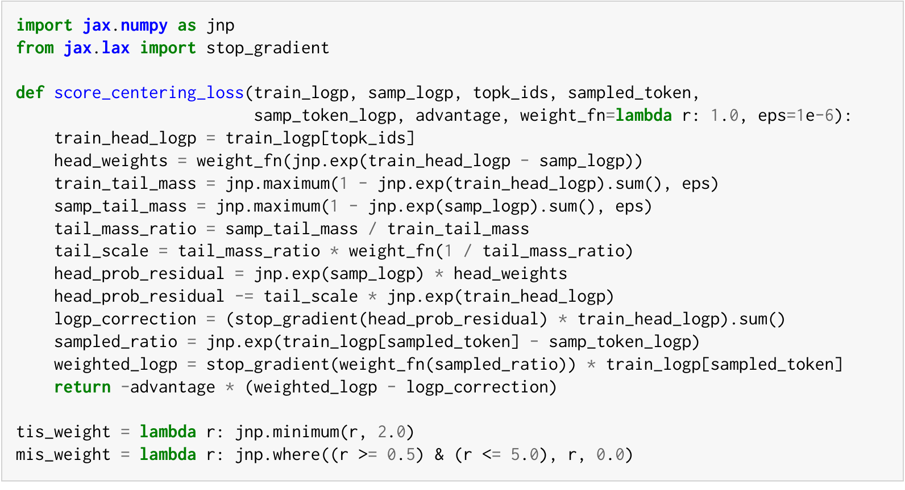
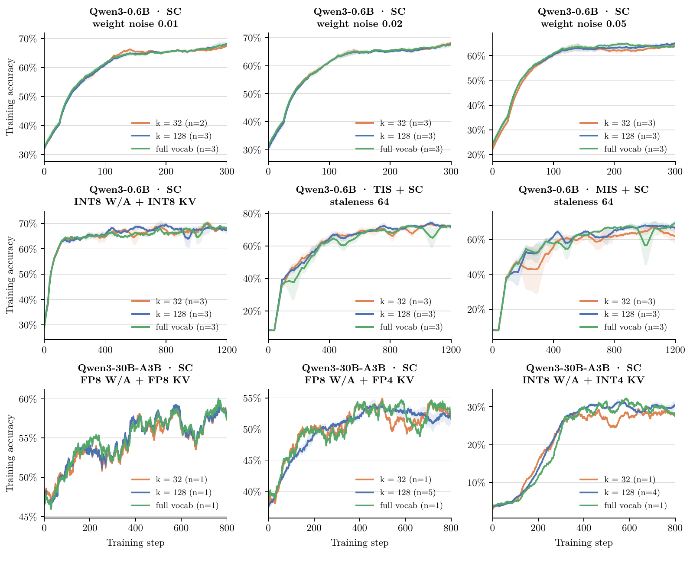

## 🧮 Appendix A · Implementing Score Centering

<!-- Complete translation of Appendix A.1–A.4, 2609.20807v1.pdf, pp. 12–15, including both derivations, generalized JAX code, and Figure 5. Original equations (7)–(12) map to (A.1)–(A.6). -->

本节对应[原论文附录 A](https://arxiv.org/pdf/2609.20807v1#page=12)，包括 top-k 近似、与重要性采样的组合、损失函数实现，以及 top-k 消融实验。附录公式（A.1）–（A.6）对应原论文公式（7）–（12）。

**符号约定** 与正文一致：固定一个前缀，$`y_t`$ 表示采样到的 token，$`v`$ 表示词表中的 token；$`p_v`$、$`q_v`$ 分别是训练器与采样器赋予它的概率，$`s_v=\nabla_\theta\log p_v`$ 是其得分，$`\bar{s}=\sum_v q_v s_v`$ 是采样器分布下的期望得分。

### A.1 Top-k Approximation

完整得分中心化在多数实际应用中的成本过高。计算正文中的得分中心化校正项，即对采样器逐 token 分布下的得分求期望，需要为每个采样位置保存完整的输出对数概率。例如，Qwen3 的词表大小约为 152K，以 FP32 保存单个位置的完整对数概率就需要约 608 KB。若一个批次包含 1024 条 rollout，每条序列长 32K，所需存储约为 20 TB。

因此，论文的实验只保存采样器分布的 top-k 近似，默认取 128。但并非仅在截断后的 top-k 分布上计算期望：还会使用训练器的对数概率补齐尾部，以近似采样器的完整分布。128 是保守的默认值；图 5 表明，即使只保留 32 个 token，也能在所有实验设置中达到与完整得分中心化相当的效果。

如何仅根据 top-k 对数概率重建采样器的完整分布？令 $`\hat q`$ 表示近似采样分布，$`H`$ 表示 top-k token 构成的头部集合，$`T`$ 表示其余 token 构成的尾部集合。头部直接使用采样器的概率，尾部使用训练器的概率，并进行缩放，使整个分布的概率之和为 1：

```math
\hat q_v=
\begin{cases}
q_v,&v\in H,\\
\rho p_v,&v\in T,
\end{cases}
\qquad
\rho=\frac{1-\sum_{v\in H}q_v}{1-\sum_{v\in H}p_v}.
\tag{A.1}
```

标量 $`\rho`$ 是采样器与训练器的尾部概率质量之比，用它缩放训练器的尾部，就能使 $`\hat q`$ 归一化。

计算重建分布下的期望得分时，不需要遍历整个词表。头部使用采样器的概率精确计算；尾部来自训练器，可以利用训练器在完整词表上的期望得分为零这一性质，将尾部之和改写为零减去头部之和：

```math
\begin{aligned}
\mathbb{E}_{\hat q}[s_{y_t}]
&=\sum_{v\in H}q_v s_v+\rho\sum_{v\in T}p_v s_v\\
&=\sum_{v\in H}q_v s_v+\rho\left(
\underbrace{\mathbb{E}_p[s_{y_t}]}_{=0}-\sum_{v\in H}p_v s_v
\right)\\
&=\sum_{v\in H}(q_v-\rho p_v)s_v.
\end{aligned}
\tag{A.2}
```

因此，虽然尾部模型覆盖了整个词表，中心化项实际上只需要计算头部的 k 个 token。

top-k 得分中心化的额外开销很小。在相同硬件条件下，论文中 0.6B 和 30B 模型采用 128 个头部 token 的训练耗时，与基线方法的差异都在 1% 以内。作者的自定义 JAX 采样器在解码过程中计算 top-k 对数概率；vLLM 和 SGLang 原生提供 top-k 对数概率接口，但论文没有测量这两个引擎的额外开销。

### A.2 Composing Score Centering with Importance Sampling

得分中心化减去的校正项是期望得分。TIS、MIS 等重要性采样方法则使用经过裁剪或掩蔽的重要性比率，对得分重新加权。因此，与重要性采样组合时，需要计算**加权得分的期望**。可以将这一过程理解为先通过重要性采样对得分加权，再对加权后的得分进行中心化。

令 $`r_v=p_v/q_v`$ 为重要性比率，$`w_v=f(r_v)`$ 为所采用的重要性采样方法赋予的权重。例如，TIS 使用 $`f(r)=\min(r,2)`$。中心化后的更新及其校正项为：

```math
R\left(w_{y_t}s_{y_t}-\mathbb{E}_q[w_{y_t}s_{y_t}]\right),
\qquad
\mathbb{E}_q[w_{y_t}s_{y_t}]=\sum_v q_v w_v s_v.
\tag{A.3}
```

与普通得分中心化一样，奖励为常数时，期望更新恰好为零。无论采用哪一种加权函数，减去期望加权得分都能从构造上抵消漂移。

式（A.2）的 top-k 化简同样适用。尾部的采样器概率只能由 $`\hat q`$ 近似，因此尾部权重也在该分布下计算：$`\hat w_v=f(p_v/\hat q_v)`$；在头部，它与 $`w_v`$ 相同。在尾部，$`p_v/\hat q_v=p_v/(\rho p_v)=1/\rho`$ 是常数，因此中心化项仍只涉及头部，只需将标量 $`\rho`$ 替换为 $`\alpha`$：

```math
\mathbb{E}_{\hat q}[\hat w_{y_t}s_{y_t}]
=\sum_{v\in H}(q_v w_v-\alpha p_v)s_v,
\qquad \alpha=\rho f(1/\rho).
\tag{A.4}
```

普通得分中心化是 $`f\equiv1`$ 的特例，此时 $`\alpha=\rho`$。作为一致性检查，若采用未经裁剪的重要性采样 $`f(r)=r`$，则 $`\alpha=1`$ 且 $`q_vw_v=p_v`$，中心化项随之消失：精确重要性采样的期望加权得分本来就为零，无须再次中心化。

### A.3 Loss Formulation

将得分中心化写成标量损失，就能在自动微分框架中高效实现。由于期望得分是逐 token 得分的加权和，$`\bar s=\sum_v q_v\nabla_\theta\log p_v`$，可以用停止梯度的采样器概率对训练器的对数概率加权。对于策略梯度，损失为：

```math
L=-R\left(
\log p_{y_t}-
\underbrace{\sum_v\operatorname{sg}[q_v]\log p_v}_{\text{centering term}}
\right).
\tag{A.5}
```

其中 $`\operatorname{sg}[\cdot]`$ 表示停止梯度，即不对采样概率求导。求导即可恢复中心化更新：$`-\nabla_\theta L=R(s_{y_t}-\bar s)=R\tilde s_{y_t}`$。结合任意重要性权重的通用 top-k 版本采用相同方式，并且只需要计算头部 token：

```math
L=-R\left(
\operatorname{sg}[w_{y_t}]\log p_{y_t}
-\sum_{v\in H}\operatorname{sg}[q_vw_v-\alpha p_v]\log p_v
\right).
\tag{A.6}
```

下面的 JAX 代码实现式（A.6），完整转录自[原论文附录 A.3，第 14 页](https://arxiv.org/pdf/2609.20807v1#page=14)。`weight_fn` 指定加权函数，默认对应普通得分中心化。与正文实现一致，`train_logp` 覆盖整个词表，`samp_logp` 保存采样器的 top-k 对数概率；新增的标量 `samp_token_logp` 保存实际采样 token 的采样器对数概率，即使该 token 不在头部也必须提供。为了数值稳定，尾部概率质量以 `eps` 为下界。

```python Score Centering · 支持 TIS / MIS 的通用实现
import jax.numpy as jnp
from jax.lax import stop_gradient

def score_centering_loss(train_logp, samp_logp, topk_ids, sampled_token,
                         samp_token_logp, advantage, weight_fn=lambda r: 1.0, eps=1e-6):
    train_head_logp = train_logp[topk_ids]
    head_weights = weight_fn(jnp.exp(train_head_logp - samp_logp))
    train_tail_mass = jnp.maximum(1 - jnp.exp(train_head_logp).sum(), eps)
    samp_tail_mass = jnp.maximum(1 - jnp.exp(samp_logp).sum(), eps)
    tail_mass_ratio = samp_tail_mass / train_tail_mass
    tail_scale = tail_mass_ratio * weight_fn(1 / tail_mass_ratio)
    head_prob_residual = jnp.exp(samp_logp) * head_weights
    head_prob_residual -= tail_scale * jnp.exp(train_head_logp)
    logp_correction = (stop_gradient(head_prob_residual) * train_head_logp).sum()
    sampled_ratio = jnp.exp(train_logp[sampled_token] - samp_token_logp)
    weighted_logp = stop_gradient(weight_fn(sampled_ratio)) * train_logp[sampled_token]
    return -advantage * (weighted_logp - logp_correction)

tis_weight = lambda r: jnp.minimum(r, 2.0)
mis_weight = lambda r: jnp.where((r >= 0.5) & (r <= 5.0), r, 0.0)
```

<details>
<summary>查看原论文代码截图（附录 A.3）</summary>
<figure class="lake-figure"><a href="assets/images/score-centering-weighted-code.png"></a></figure>
</details>

传入 `weight_fn=tis_weight` 或 `weight_fn=mis_weight`，即可分别与 TIS 或 MIS 组合。与式（A.6）一致，采样 token 的重要性权重和中心化系数都停止梯度。

### A.4 Top-k Ablation

图 5 比较了全部实验设置中的 top-k 得分中心化与完整得分中心化。保留 32 个或 128 个 token，在每一种设置下都能达到与完整得分中心化相当的效果。

式（A.1）的尾部模型只需要处理 top-k 头部以外的采样器概率质量，论文在每个训练步骤都会记录这一质量。当头部包含 128 个 token 时，除 30B 模型的 INT8 W/A + INT4 KV 设置外，所有设置中头部覆盖的平均概率质量都超过 99.9%。在这一例外设置中，平均覆盖率为 99.45%，最差批次为 95.8%。这是尾部分布受量化影响最严重的设置，但图 5 表明，保留 32 个或 128 个 token 仍与完整得分中心化相当。

<figure class="lake-figure">
<a href="assets/images/score-centering-topk-ablation.png"></a>
<figcaption>图 5 · 得分中心化的 top-k 消融实验。使用 128 个或 32 个采样器对数概率，并采用式（A.1）的尾部模型，即可在所有测试设置下达到与全词表得分中心化相当的效果。每条曲线使用的随机种子数标在图例中。<a href="https://arxiv.org/pdf/2609.20807v1#page=15">原论文第 15 页</a> · 点击图片查看原图。</figcaption>
</figure>
