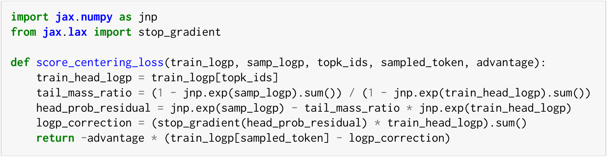

使用 top-k 中的 128 个、甚至 32 个 token，即可在论文测试的所有设置中达到与完整得分中心化相当的效果，详见附录 A.4。下面是针对单个 token 的最小实现，对应[原论文 §4.1，第 6 页](https://arxiv.org/pdf/2609.20807v1#page=6)。

```python Score Centering · 单 token 最小实现
import jax.numpy as jnp
from jax.lax import stop_gradient

def score_centering_loss(train_logp, samp_logp, topk_ids, sampled_token, advantage):
    train_head_logp = train_logp[topk_ids]
    tail_mass_ratio = (1 - jnp.exp(samp_logp).sum()) / (1 - jnp.exp(train_head_logp).sum())
    head_prob_residual = jnp.exp(samp_logp) - tail_mass_ratio * jnp.exp(train_head_logp)
    logp_correction = (stop_gradient(head_prob_residual) * train_head_logp).sum()
    return -advantage * (train_logp[sampled_token] - logp_correction)
```

<details>
<summary>查看原论文代码截图（§4.1）</summary>
<figure class="lake-figure"><a href="assets/images/score-centering-minimal-code.png"></a></figure>
</details>

完整推导和支持重要性权重的通用实现见下面的附录 A。
